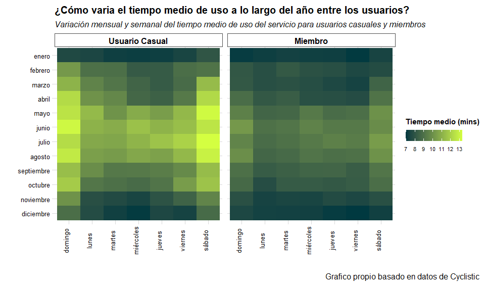
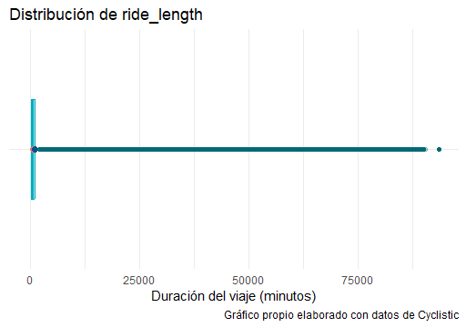
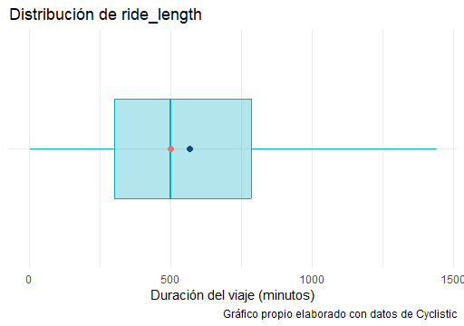
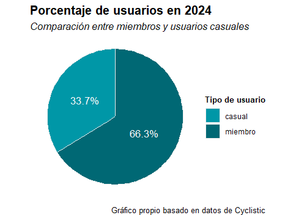
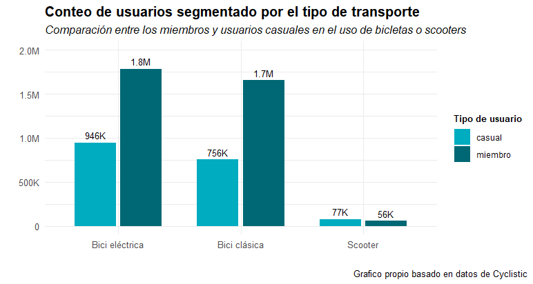
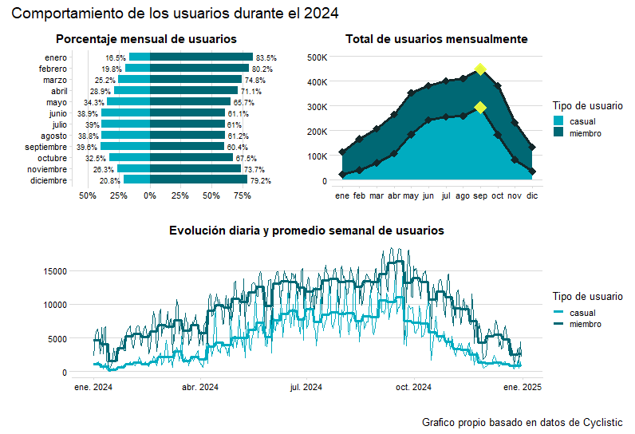
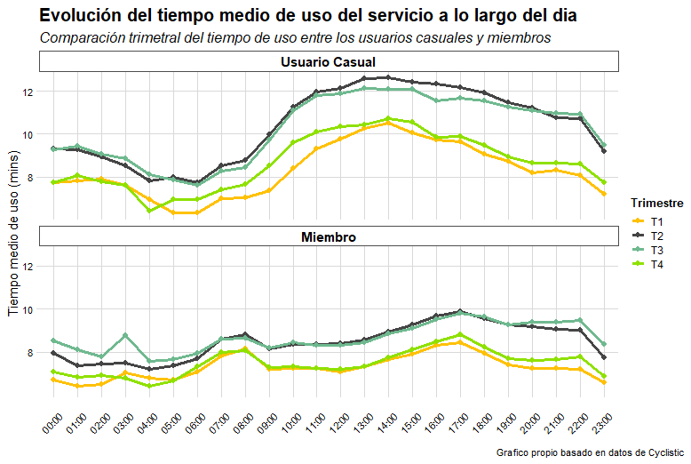

<h1> Análisis de Uso de Bicicletas y Estrategias de Conversión de Usuarios - Cyclistic </h1>

# Resumen

Análisis del histórico de viajes de 2024 de **Cyclistic** (programa de bicicletas compartidas en Chicago) para diseñar estrategias de marketing que conviertan a los usuarios casuales en miembros anuales.

- **Datos:** 12 archivos `csv` de 2024 (5,860,568 viajes), que quedaron en 5,273,363 viajes tras la limpieza. Procesados con **R**.
- **Hallazgos:** los miembros son mayoría en todos los meses. Los usuarios casuales tienen un mayor tiempo medio de uso, concentrado en fines de semana y en primavera-verano, lo que sugiere un uso recreativo; los miembros tienen un uso más constante, lo que sugiere un uso como parte de su rutina diaria.
- **Recomendaciones:** cinco estrategias: descuentos en el primer trimestre, acceso temporal a funciones de miembro, sistema de puntos, eventos exclusivos para miembros y estrategia digital con retargeting.



---

# Contexto y pregunta de negocio

## Sobre la empresa

Cyclistic es un programa de **bicicletas compartidas** en Chicago que ha crecido desde 2016 hasta contar con 5,824 bicicletas y 692 estaciones. Su estrategia de marketing se ha basado en atraer diversos segmentos de consumidores a través de planes flexibles de precios, incluyendo pases de un solo viaje y membresías anuales. Los clientes que optan por pases ocasionales se denominan **usuarios casuales**, mientras que aquellos que cuentan con membresías anuales son considerados **miembros de Cyclistic**.

Los analistas financieros determinaron que los miembros de Cyclistic generan mayores beneficios que los ciclistas ocasionales. Por ello, la directora de marketing Lily Moreno busca estrategias para convertir a más ciclistas ocasionales en miembros de Cyclistic. Para lograr este objetivo, es necesario estudiar las diferencias entre ambos grupos, los factores que motivan a los ciclistas ocasionales a adquirir una membresía y el impacto de los medios digitales en su decisión.

## Business Task

> *Diseñar estrategias de marketing orientadas a convertir a los ciclistas ocasionales en miembros anuales de Cyclistic*

## Preguntas clave del análisis

Las siguientes preguntas sirven como guía para desarrollar el proyecto:

1. ¿En qué se diferencian los socios anuales y los usuarios ocasionales con respecto al uso del servicio de Cyclistic?
2. ¿Por qué los ciclistas ocasionales comprarían membresías anuales de Cyclistic?
3. ¿Cómo puede usar Cyclistic los medios digitales para influenciar a los usuarios a convertirse en miembros?

## Stakeholders o interesados en el proyecto

1. **Lily Moreno.** Gerente y directora de marketing. Es responsable del desarrollo de campañas e iniciativas para promover el programa de bicicletas compartidas. Tiene un alto interés en el proyecto, pero no es quien aprueba el programa de marketing recomendado.
2. **Equipo de ejecutivos de Cyclistic.** Son quienes aprueban el programa de marketing recomendado. Mantener satisfechos.

---

# Datos y diccionario

## Sobre el conjunto de datos

Los datos fueron proporcionados por [Motivate International Inc](https://divvy-tripdata.s3.amazonaws.com/index.html) y están bajo esta [licencia](https://divvybikes.com/data-license-agreement). Esto significa que los datos son públicos y se pueden copiar, modificar, analizar, distribuir o usar de cualquier forma legal. Sin embargo, por cuestiones de privacidad está prohibido usar información de identificación personal de los ciclistas.

## Detalles de los datos

El conjunto de datos está formado por doce archivos `csv`, que forman el histórico del año 2024.

Cada tabla contiene información sobre los viajes realizados por los usuarios (la información del usuario es anónima) e incluye:

- Fecha y hora de inicio de viaje
- Fecha y hora de fin de viaje
- Estación de inicio
- Estación de término
- Tipo de usuario

## Diccionario de columnas

| Nombre de columna   |   Tipo    | Descripción                                    |
| :------------------: | :-------: | ---------------------------------------------- |
|      `ride_id`       | character | ID único designado a cada unidad               |
|   `rideable_type`    | character | Bicicleta clásica, eléctrica o scooter         |
|     `started_at`     | character | Fecha y hora de inicio de viaje                |
|      `ended_at`      | character | Fecha y hora de fin de viaje                   |
| `start_station_name` | character | Nombre de la estación del comienzo de viaje    |
|  `start_station_id`  | character | ID de la estación donde comenzó el viaje       |
|  `end_station_name`  | character | Nombre de la estación de finalización de viaje |
|   `end_station_id`   | character | ID de la estación donde terminó el viaje       |
|     `start_lat`      |  double   | Latitud de la estación inicial                 |
|     `start_lng`      |  double   | Longitud de la estación inicial                |
|      `end_lat`       |  double   | Latitud de la estación final                   |
|      `end_lng`       |  double   | Longitud de la estación final                  |
|   `member_casual`    | character | Tipo de membresía que posee                    |

Valores únicos de las columnas de interés:

| Columna         | Elementos únicos                                     |
| --------------- | ---------------------------------------------------- |
| `rideable_type` | "electric_bike", "classic_bike" y "electric_scooter" |
| `member_casual` | "member" y "casual"                                  |

---

# Metodología y decisiones

## Herramientas

1. **Spreadsheet (Excel u hojas de cálculo de Google).** Para una inspección rápida de los datos antes del procesamiento y después de procesar, para garantizar la integridad de los datos.
2. **R.** Para el procesamiento y limpieza de los datos y para realizar las visualizaciones del análisis.

## Exploración y verificación de integridad

Para las doce tablas se verificó que todas contienen el mismo nombre en sus columnas. Esto fue verificado con el siguiente código:

```R
tables_info = list()
for(i in 1:12){
  csv_name <- paste0(datapath,file_year,file_months[i],"-divvy-tripdata.csv")
  data_tmp <-  read.csv(file = csv_name,nrows = 3) 
  cols_names_tmp <- colnames(data_tmp)
  table_cols <- paste0(cols_names_tmp)
  table_info <-  table_info %>% 
                 append(paste0("|", paste0(cols_names_tmp, collapse = "|"), "|"))
}

tables_info <- length(unique(table_info)) == 1 # TRUE si las columnas de los archivos son iguales
```

Una vez verificado esto, se procedió a verificar si el tipo de dato de las columnas es el correcto (ver tabla de la sección anterior). Luego se verificaron los valores únicos de las columnas `rideable_type` y `member_casual`, que son las de interés para el análisis, y no fue necesario realizar ningún ajuste sobre ellas. El proceso para verificar la integridad de los datos puede encontrarse [aquí](./data_integrity.R).

## Unión de las tablas

Para agilizar el ajuste de tipo de las columnas y la limpieza de datos, se decidió unir todas las tablas en una sola. Esto es posible porque las tablas presentan consistencia en el nombre y el tipo de sus columnas.

```R
# data_cp es una tabla arbitraria de nuestro conjunto de datos,
n <-  length(colnames(data_cp))
all_trips <-  data.frame(matrix(ncol = n, nrow = 0))
colnames(all_trips) <- colnames((data_cp))
for(i in 1:12){
  # file_year <- "2024"
  csv_name <- paste0(datapath,file_year,file_months[i],"-divvy-tripdata.csv")
  data_tmp <-  read.csv(file = csv_name)
  all_trips <- rbind(all_trips,data_tmp) 
}
```

Así se obtuvo una tabla con 5,860,568 renglones y 13 columnas.

## Limpieza y transformación

Antes de realizar las modificaciones a la tabla `all_trips`, se trabajó sobre una copia llamada `all_trips_table`, que es una versión mejorada de un *dataframe* proporcionada por la librería [data.table](https://cran.r-project.org/web/packages/data.table/). Las operaciones realizadas fueron:

1. **Agregado de columnas.** A partir de `started_at` y `ended_at` se agregaron columnas con la fecha de inicio de viaje, el día de inicio de viaje (por nombre y número) y la fecha de fin del viaje. Además se agregó `ride_length`, que indica la duración del servicio en minutos.
2. **Datos faltantes.** En `start_station_name` y `end_station_name` se encontraron nombres vacíos; estos valores fueron llenados con `unknown station`.
3. **Limpieza.** No se encontraron elementos repetidos ni nulos. Se eliminaron las columnas de latitud y longitud de las estaciones de inicio y de término. También se eliminaron los viajes que iniciaron y terminaron en días distintos, ya que el análisis busca concentrarse en el uso común del servicio.
4. **Límites de `ride_length`.** Se encontraron valores negativos e iguales a cero, que representan alrededor del 0.01% de los datos; fueron eliminados. La distribución de esta variable presenta outliers:



   | Media | Mediana | Moda |
   | :-----------: | :----------: | :----------: |
   | 17.31 minutos | 9.72 minutos | 4.87 minutos |

   Como hay una diferencia significativa entre estos valores, se decidió utilizar la técnica [IQR](https://en.wikipedia.org/wiki/Interquartile_range) para filtrar los outliers, con una ligera variación en la selección de $Q_1$: se tomó $Q_1 = 1$, es decir, se descartaron los viajes que duraron menos de un minuto. La distribución resultante es:



   | Media | Mediana | Moda |
   | :-----------: | :----------: | :----------: |
   | 11.19 minutos | 9.18 minutos | 4.87 minutos |

El código de todo el proceso de limpieza puede consultarse en [data_cleaning.R](./data_cleaning.R).

Después de la limpieza se obtuvo una tabla de **5,273,363 filas y 16 columnas**.

---

# Resultados

Los siguientes gráficos son los hallazgos encontrados en los datos.

## Frecuencia de los usuarios



> **Los usuarios *miembro* fueron los más abundantes durante el año 2024**

## Transporte favorito de los usuarios



> 1. **Las *bicicletas eléctricas* fueron las más utilizadas tanto por los usuarios *casuales* como por los *miembros*.**
> 2. **Las *bicicletas clásicas* son el segundo transporte más utilizado y la diferencia con la primera no es alta.**
> 3. **El *scooter* es el transporte menos utilizado por los dos tipos de usuarios.**

## Resumen anual

El siguiente gráfico está dividido en tres paneles que representan:

1. El porcentaje de usuarios que utilizaron el servicio mensualmente.
2. El conteo mensual de usuarios, indicando el mes con mayor número de usuarios activos.
3. El conteo diario de usuarios (líneas tenues), así como el promedio semanal de usuarios (líneas anchas).



> 1. Distribución de usuarios por mes:
> 	- **Los usuarios *miembros* representan la mayoría de los usuarios en todos los meses.**
> 	- **Hay un incremento en la participación de los usuarios *casuales* en los meses de marzo a septiembre, siendo septiembre donde alcanza su máxima participación.**
> 2. Tendencia mensual del total de usuarios:
> 	- **Tanto los usuarios casuales como los miembros presentan un incremento en los meses de febrero y septiembre, siendo septiembre el mes con el mayor número de usuarios de ambos tipos.**
> 	- **Hay una clara disminución en el número de usuarios activos durante los meses de octubre a enero, mostrando cómo los periodos otoño-invierno influyen en el uso del servicio.**
> 3. Evolución diaria y promedio semanal:
> 	- **Se observa una tendencia ascendente hasta mediados de año, con un mayor número de usuarios en verano.**
> 	- **La fluctuación diaria sugiere un patrón de uso constante con variaciones semanales, probablemente más uso en días específicos como fines de semana o días festivos.**

## Tiempo medio de uso del servicio a lo largo del día

El siguiente gráfico muestra cómo varía el tiempo medio de uso del servicio en un día completo. El cálculo se obtiene tras segmentar el año en cuatro trimestres (T1, T2, T3 y T4), para observar con mejor claridad los patrones entre distintas temporadas.



> 1. Diferencias de tiempos entre los dos tipos de usuario:
> 	- **Los usuarios *casuales* presentan un mayor tiempo medio de uso del servicio que los usuarios *miembros*.**
> 	- **Los *miembros* son quienes usan menos tiempo el servicio, lo cual podría indicar que realizan viajes más cortos, o bien, viajes diarios.**
> 2. Patrón de uso a lo largo del día:
> 	- **Ambos tipos de usuario presentan un incremento en el tiempo medio de uso del servicio en las mañanas, siendo más visible en los usuarios *casuales*.**
> 	- **El tiempo de uso alcanza su máximo entre las 12:00 y 15:00 horas para los usuarios casuales. Esto podría indicar que el uso del servicio es para actividades recreativas.**
> 	- **El tiempo medio de uso de los usuarios miembro tiene picos menos pronunciados durante el día. Su uso es más estable a lo largo del día.**
> 3. Variación por trimestre:
> 	- **Los trimestres T2 y T3 son los que reportan un tiempo de uso mayor respecto a los otros trimestres. Esto podría estar relacionado con las condiciones climáticas de la primavera y el verano.**
> 	- **Los trimestres T1 y T4 son los que reportaron menores tiempos de uso respecto a los demás. Esto sugiere que las condiciones climáticas del otoño y el invierno afectan el uso del servicio.**

## Tiempo medio de uso durante la semana

El siguiente gráfico de calor muestra cómo varía el tiempo medio de uso de cada día de la semana durante cada mes del año 2024. Un color más claro indica mayor tiempo medio de uso, mientras que un color más oscuro indica menor tiempo medio de uso.


> 1. Diferencias de tiempos entre los dos tipos de usuario:
> 	- **Los usuarios casuales tienen tiempos medios de uso más altos, siendo los fines de semana los más activos, especialmente los meses de mayo a agosto.**
> 	- **Los usuarios miembro presentan un comportamiento más constante a lo largo del año, con ligeras variaciones, pero generalmente inferior respecto a los usuarios casuales.**
> 2. Estacionalidad en el uso:
> 	- **El tiempo de uso aumenta durante la primavera y el verano (abril-agosto), en especial para los usuarios casuales. Nuevamente, esto podría indicar que el uso es para fines recreativos en esta temporada.**
> 	- **Durante el otoño y el invierno (septiembre-diciembre), el tiempo medio de uso disminuye, lo que sugiere menor interés por parte de los usuarios casuales debido a condiciones climáticas.**
> 3. Diferencias entre fines de semana:
> 	- **Usuarios casuales: el uso es más alto en los fines de semana, lo que refuerza la idea de que las bicicletas se usan más con fines recreativos.**
> 	- **Miembros: no muestran un incremento tan notable los fines de semana, lo que sugiere que utilizan el servicio de manera más homogénea a lo largo de la semana, posiblemente como parte de su rutina diaria (desplazamientos al trabajo o estudio).**

## Recomendaciones

Después de revisar los resultados del análisis, estas son las propuestas para incentivar que los usuarios casuales adquieran la membresía anual de Cyclistic:

1. **Ofrecer descuentos atractivos durante el primer trimestre del año.**
   Se observó que la actividad de los usuarios es baja en enero, pero comienza a aumentar a medida que mejoran las condiciones climáticas. Para aprovechar esta tendencia, se pueden ofrecer descuentos especiales en la membresía anual, incentivando a los usuarios casuales a suscribirse al inicio del año.

2. **Dar acceso temporal a las funciones exclusivas de los miembros.**
   Cyclistic podría ofrecer a los usuarios casuales un periodo de prueba con acceso a los beneficios de la membresía, con una duración mínima de una semana. Esta estrategia sería especialmente efectiva a finales de marzo y durante abril, dirigida a usuarios casuales con cierta antigüedad en el servicio, quienes podrían valorar más las ventajas de la suscripción.

3. **Implementar un sistema de puntos basado en la actividad.**
   Se sugiere desarrollar un sistema de recompensas en el que los usuarios acumulen puntos según el tiempo de uso de bicicletas o scooters. Por ejemplo, 1 minuto de viaje podría equivaler a 10 puntos, y los fines de semana la tasa de acumulación podría incrementarse en un 50%. Estos puntos podrían canjearse por descuentos en membresías, productos exclusivos de Cyclistic o utilizarse en un sistema de ranking semanal que fomente una mayor participación de ambos tipos de usuarios.

4. **Organizar eventos exclusivos para miembros.**
   Se identificó que los usuarios miembros presentan un uso más constante a lo largo del año y los días de la semana, lo que indica que integran el servicio en su rutina diaria. Para fortalecer su compromiso y atraer a usuarios casuales, Cyclistic podría organizar eventos como paseos grupales, desafíos de exploración o actividades temáticas por temporada. Estas iniciativas no solo aumentarían el *engagement* de los miembros, sino que también despertarían el interés de los usuarios casuales en la suscripción.

5. **Estrategia digital y retargeting en redes sociales.**
   Cyclistic puede lanzar campañas personalizadas en redes sociales y correo electrónico, destacando los beneficios de la membresía anual. A través del *retargeting*, se pueden mostrar anuncios a usuarios casuales frecuentes con mensajes como:
   _"Ahorra en tus viajes y disfruta de trayectos ilimitados con la membresía Cyclistic."_

---

# Limitaciones y siguientes pasos

## Limitaciones

- Solo se analizó el año 2024.
- La información de los usuarios es anónima y está prohibido usar información de identificación personal, por lo que el análisis compara a los dos grupos de usuarios en conjunto.
- Decisiones de limpieza que afectan el alcance: se eliminaron los viajes que iniciaron y terminaron en días distintos, los viajes con duración menor a un minuto o inconsistente y los outliers por IQR. En total se pasó de 5,860,568 a 5,273,363 viajes.
- Se eliminaron las columnas de latitud y longitud, por lo que el análisis no incluye la dimensión geográfica.
