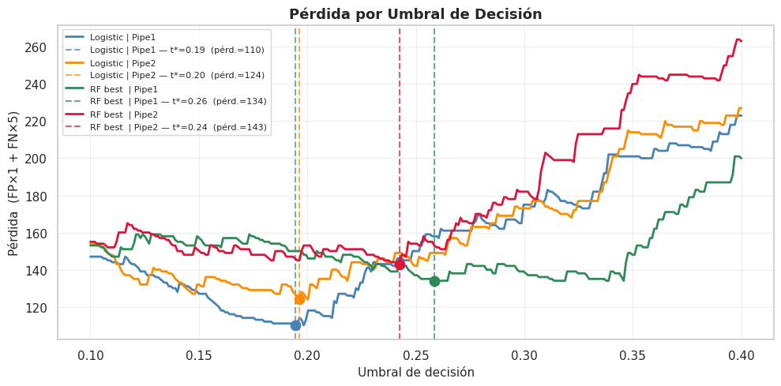

# Otorgamiento de Crédito 🏦 

> Proyecto de análisis no supervisado y supervisado para apoyar decisiones de otorgamiento crediticio mediante la identificación de perfiles de riesgo en clientes bancarios.

---

## Descripción del Proyecto

El otorgamiento de crédito es un proceso crítico en la banca y las instituciones financieras, donde se evalúa la probabilidad de que un solicitante incumpla con sus obligaciones de pago. Una adecuada gestión del riesgo permite minimizar pérdidas y optimizar la cartera crediticia.

Este proyecto aborda el problema utilizando el conjunto de datos **Statlog (German Credit Data)** del UCI Machine Learning Repository, que contiene información de 1,000 solicitudes de crédito junto con una etiqueta que indica si el cliente es buen o mal pagador.

### Objetivo general

Desarrollar un pipeline reproducible de segmentación y clasificación de clientes que minimice el riesgo de otorgar crédito a clientes con alta probabilidad de incumplimiento, incorporando una función de pérdida asimétrica que refleja el costo diferenciado de cada tipo de error.

### Objetivos específicos

- Evaluar si los datos presentan estructura natural de clusters alineada con la etiqueta bueno/malo mediante modelos no supervisados (KMeans y DBSCAN)
- Construir y comparar modelos de clasificación supervisada (Regresión Logística y Random Forest) sobre dos esquemas de preprocesamiento
- Seleccionar el umbral de decisión óptimo bajo una función de pérdida asimétrica: clasificar un mal cliente como bueno es **5 veces más costoso** que el error inverso

---

## Metodología

### Datos

El dataset **Statlog (German Credit Data)** fue aportado por el Prof. Dr. Hans Hofmann de la Universidad de Hamburgo y está disponible en el [UCI ML Repository](https://archive.ics.uci.edu/dataset/144/statlog+german+credit+data) (ID: 144). Contiene 1,000 registros de solicitudes de crédito con 20 atributos de naturaleza mixta y una variable objetivo binaria.

| Tipo de variable | Atributos | Descripción |
|---|---|---|
| Numéricas | `Attribute2`, `Attribute5`, `Attribute8`, `Attribute11`, `Attribute13`, `Attribute16` | Variables financieras continuas (monto, duración, edad, etc.) |
| Ordinales | `Attribute1`, `Attribute6`, `Attribute7`, `Attribute17` | Categorías con orden natural (estatus de cuenta, ahorros, empleo, tipo de trabajo) |
| One-Hot | `Attribute3`, `Attribute4`, `Attribute9`, `Attribute10`, `Attribute12`, `Attribute14`, `Attribute15`, `Attribute19`, `Attribute20` | Variables categóricas nominales |
| **Target** | `class` | 1 = Mal cliente, 0 = Buen cliente (700 buenos / 300 malos) |

### Preprocesamiento

Las funciones `build_num_preprocessor` y `build_cat_preprocessor` están definidas en `src/configs.py`. Se construyeron dos pipelines de transformación:

| Pipeline | Descripción |
|---|---|
| **Pipeline 1** | Escalado + PCA (95% varianza) aplicado únicamente sobre variables numéricas |
| **Pipeline 2** | Escalado + PCA (95% varianza) aplicado sobre todo el espacio preprocesado |

### Modelos evaluados

**No supervisados** (`src/clustering_settings.py`)
- **KMeans** — búsqueda de K óptimo con Silhouette, Calinski-Harabasz y Davies-Bouldin sobre rango (2, 11)
- **DBSCAN** — grid search sobre `eps` y `min_samples`, filtrando configuraciones con > 30% de ruido

**Supervisados** (`src/classification_settings.py`)
- **Regresión Logística** — configuración por defecto con validación cruzada estratificada (5 folds)
- **Random Forest** — optimización de hiperparámetros vía GridSearchCV con `scoring='recall'`

---

## Resultados y Conclusiones

### Segmentación no supervisada

Los modelos de clustering **no lograron capturar la estructura binaria** del riesgo crediticio. Los indicadores de alineación con la etiqueta real fueron prácticamente nulos en todos los experimentos (ARI ≈ 0, NMI < 0.025), lo que indica que buenos y malos clientes no forman agrupaciones naturales distinguibles en el espacio de características disponibles.

| Modelo | Silhouette | ARI | NMI |
|---|---|---|---|
| KMeans K=2 \| Pipe1 | 0.1114 | -0.0053 | 0.0034 |
| KMeans K=2 \| Pipe2 | 0.0707 |  0.0077 | 0.0029 |
| DBSCAN \| Pipe1      | 0.2632 |  0.0005 | 0.0000 |
| DBSCAN \| Pipe2      | 0.2600 |  0.0076 | 0.0020 |

### Clasificación supervisada

El modelo seleccionado es **Random Forest con Pipeline 1** (PCA sobre variables numéricas), operando con un **umbral de decisión de 0.2585**.

| Métrica | Buen cliente | Mal cliente |
|---|---|---|
| Precision | 0.89 | 0.47 |
| Recall | 0.61 | **0.83** |
| F1-Score | 0.72 | 0.60 |
| **Accuracy** | | **0.67** |
| **ROC-AUC** | | **0.77** |
| **Average Precision** | | **0.62** |

### Función de pérdida

La función de pérdida está determinada por

> $$ \text{Pérdida} = FP × 1 + FN × 5$$

donde: 
- **FP** — Buen cliente clasificado como malo (rechazo innecesario, costo 1)
- **FN** — Mal cliente clasificado como bueno (riesgo crediticio real, costo 5)

Para umbrales en un rango de 0.1 a 0.4, los modelos tienen las siguientes pérdidas

    

El modelo seleccionado alcanza una **pérdida de 134** en el conjunto de prueba con el umbral óptimo, priorizando la captura del 83% de los clientes malos como criterio rector.

---

## Consideraciones

- El dataset se descarga automáticamente desde el UCI ML Repository vía `ucimlrepo` al ejecutar el notebook.
- El umbral óptimo (0.2585) puede variar si cambia la proporción de buenos/malos en la cartera activa. Se recomienda revisión trimestral.
- La función de pérdida asume un ratio 1:5 entre el costo de rechazo innecesario y el costo de aprobación indebida. Si el equipo de Riesgo recalibra estos valores, basta modificar `cost_fp` y `cost_fn` en la llamada a `plot_costo_umbral`.
